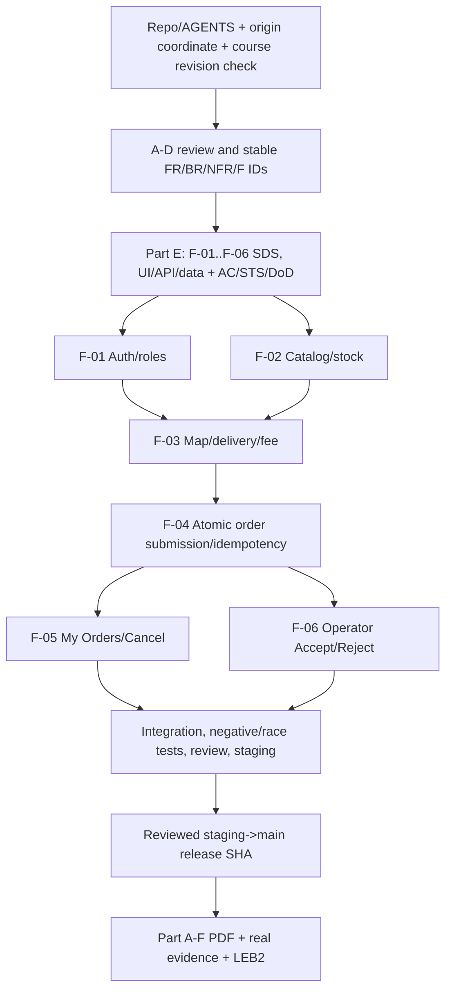

# Campus Store — Three-Sprint Delivery Plan (Part D)

> **Status correction (2026-11-03):** PR #1 was approved and merged to `sprint/1-staging`; Issue #2 is Done. All nine work-package Issues now exist (#2?#10); GP-01 = [Issue #3](https://github.com/Tanaboonnnnn/SE-Project-God-of-Merchandise-Store/issues/3), PR #11 currently under review. Historical instructions below forbidding Issue creation / describing only GP-02 as created are **superseded**. No implementation tests have passed. **Capacity gate remains open:** the team has not provided verified day-by-day availability; 67?111 person-hours are estimates, not committed hours. Before accepting a Sprint 1 completion forecast, both contributors must record hours available on 3,4,5,6,7,8 Nov and revise schedule/risks accordingly; escalate a scope/deadline change to instructor if insufficient.

> **Status:** Draft v0.2, 2026-11-02; revised for teammate **CR-ENG-001 (PR #1, Changes Requested)**. Business scope of **Sprint 1 remains frozen by FRZ-S1 (DEC-001..034 and MAP-COST-001)**. The group repo was inspected at its documentation-only starting state; **actual team availability, stack and estimates are not yet validated**. No application implementation or test execution has occurred.
>
> **Instructor source:** `group_work_specs_v1.pdf` §§4,7–9 and `project_deliverable_1_v1.pdf` §3.4. Source master is labelled *Draft for instructor review*. Check for latest authoritative version before final submission.

## 1. Product baseline and course milestones

The product is a **one-store delivery-only Campus Store**. Sprint 1 must show an authenticated Customer creating and retrieving a persisted multi-item order and Operator Accept/Reject, with authoritative price/quantity/inventory rules and backend role/ownership checks. The **approved additions** are nationwide delivery-address/map-pin selection, no-fee public tiles, server-side straight-line shipping bands, immutable order snapshots, stock reservation and release, Customer Pending cancellation, Idempotency Key and map-error recovery. These additions are **not optional** unless an explicit post-freeze scope change is approved.

| Date (Asia/Bangkok, 23:59 deadline where given) | Checkpoint | Expected deliverable / evidence |
|---|---|---|
| **8 Nov 2026** | Project Deliverable 1 (80 pts) | A–D system baseline, Part E Sprint 1 contracts, Part F running UI→API→DB release on `main` with real tests/PR review, self-contained PDF |
| **15 Nov 2026** | Group Lab 5 | Docker packaging, CI/CD, GCP deployment of accepted Sprint 1 increment (course resource access permitting) |
| **22 Nov 2026** | Group Lab 6 | Cross-team UAT and recorded defects against integrated deployed product |
| **29 Nov 2026** | Project Deliverable 2 (70 pts) + Group Lab 7 | All Sprint 2 features complete; Sprint 3 contracts and demonstrable progress; integrated deployed candidate; maintenance/regression evidence |
| **13 Dec 2026** | Final project delivery (100 pts) | Complete integrated product, QA/release evidence, final PDF, deployed app and demonstration video per final handout |

The **course theme** states: later sprints cover **catalog editing**, **cancellation/fulfillment**, **simulated payment** and **reporting**. Because DEC-018 brought Customer Pending cancellation to Sprint 1, Sprint 2 focuses on further lifecycle/fulfillment instead of deferring the already-approved cancellation. Real payments remain out of scope throughout the project.

## 2. Sprint goals, feature allocation and DoD

| Sprint | Goal | Features and boundaries | Dependencies | Completion criterion |
|---|---|---|---|---|
| **1: by 8 Nov** | Small local releasable domain slice, authenticated and tested end-to-end | **F-01** seeded auth/roles, **F-02** six-product catalog/variants/stock, **F-03** destination/map/fee, **F-04** immutable atomic ordering/idempotency, **F-05** owner order list/status/cancel, **F-06** shared Operator Accept/Reject + reason | 1→2→3→4→5/6; verifiable origin/pin policy and DB transactions | Correct S1 contracts, AC/STS/DoD, working UI→API→persistent DB, negative/race tests, local setup, teammate-reviewed PRs, accepted `main` SHA, Part A–F PDF |
| **2: by 29 Nov** | Complete core commerce expansion and Lab 5 deployment | **F-07** Operator catalog maintenance, **F-08** fulfillment / delivery state transitions, **F-09** simulated payment statuses (no money); keep F-01..06 regression green | S1 release accepted; GCP access via Lab 5; agree S2 state/permission contracts; UAT issues triaged | All planned S2 capabilities contract-first, implemented and tested; deployed integrated candidate on `main`; Sprint 3 contracts and real started F-10/F-11 work shown in Deliverable 2 |
| **3: progress by 29 Nov; complete by 13 Dec** | Reporting, quality hardening and final release | **F-10** order/sales summaries and authorized aggregates; **F-11** UX, failure handling, UAT/maintenance fixes, regression/security/performance/accessibility, final QA | Fulfillment/payment/catalog state definitions and persistent history from S2; UAT & defects | Source-grounded reporting and reliability tests, no high-severity unresolved defect without disclosure, final deployed tagged release, evidence PDF + ≤10min final video per instructor handout |

**Part E preparation:** Before coding any S1 feature, a versioned Feature-Level SDS must define workflows, UI/API/data, business rules, auth, errors/edge cases, stable AC, corresponding STS/TEST, DoD. The feature inventory currently lists **planned** AC/TEST names; these are not completed Part E documents. The same discipline applies to F-07..F-11 before their implementation.

## 3. Sprint 1 dependency and release path

**Hard gates before application edits:** identify actual group repository and its `AGENTS.md`; compare existing stack and conventions; verify exact shipping origin; finalize engineering decisions that cannot be safely guessed; prepare and review F-01..06 Part E contracts. The earlier plan dated 1 Nov is **superseded** because it says counter pickup, no shipping and later cancellation. Do not follow it for code execution.

## 4. Short-window Sprint 1 schedule (planning targets, not promises)

| Date | Work and validation gate | Assignment / reviewer intent |
|---|---|---|
| **2 Nov** | FRZ-S1 approved; draft Part A–D; record plan conflict, decision trace, evidence gaps | Both review requirements and sign off the baseline; no code in this documentation session |
| **3 Nov** | Inspect repo baseline and confirm origin/datasets/stack; finalize S1 F-01..F-06 contracts/STS and response to CR-ENG-001. **Do not create additional Issues until PR #1 receives teammate approval/merge**, as agreed by the team. | Both contribute contracts; cross-review, confirm available hours and assignment |
| **4 Nov** | Build/test identity and catalog foundation with migrated/seeded DB (only after contract gate) | Split vertical slices; reciprocal PR review |
| **5 Nov** | Implement/test map/checkout distance/fee and transactional order submission + snapshots/idempotency | Shared review of backend cost/stock test cases |
| **6 Nov** | Complete Customer order list/cancel and Operator Accept/Reject; cover permission failures, invalid input and races | Both write tests and inspect each other's status changes |
| **7 Nov** | Integration/staging, regression/E2E, review release PR, record SHA, gather real evidence | Both verify and review; feature scope hard stop, fix defects |
| **8 Nov** | Reproduce setup/build/tests on release SHA; compile *self-contained* Parts A–F PDF including actual counts/PRs/screenshots; submit through LEB2 before 23:59 | Both sign off what is actually passing, disclose failures/skips |

**Risk assessment:** **HIGH**: six dependent Sprint 1 feature groups plus a new map/shipping subsystem and multi-actor stock concurrency are ambitious for two students. The schedule is a tentative critical path; do not assert feasibility without confirming both members' hours and completing a proof-of-concept on the actual database. If it fails, raise a formal FRZ-S1 scope-change request (with impact and instructor consultation as appropriate) rather than silently omitting approved features.

### CR-ENG-001 E — Estimated effort, dependencies and capacity gates (proposal, NOT commitments)

The following are **initial planning ranges in total person-hours**, not time logs or promises. They assume a greenfield repository (confirmed on 2 Nov), a chosen relational DB and both members able to contribute. If a reusable starter is adopted or any integration fails, re-estimate. **Do not create the candidate GitHub Issues until the current PR #1 review is accepted.**

| Work package | Proposed owner / reviewer | Dependencies | Estimated person-hours | Exit evidence / gate |
|---|---|---|---:|---|
| GP-01 readiness, stack, coordinates | Both / reciprocal | None | 3–5 | Source-verified origin, DB/stack and test commands recorded |
| GP-02 requirements/design review | A / B | FRZ-S1 | 2–4 | PR #1 reviewed; requested changes addressed |
| GP-03 Part E contracts, F-01..06 | Split A: F-01/04/05, B: F-02/03/06; reciprocal review | GP-01/02 | 8–14 | Reviewed UI/API/data/AC/STS/DoD before code |
| F-01 login and authorization | A / B | GP-03 | 6–10 | Real seeded login/role/negative tests |
| F-02 catalog and stock | B / A | GP-03 | 5–8 | DB seed and 6-product/12-option read tests |
| F-03 delivery/map/fee | B / A | F-01, F-02, verified origin | 9–15 | Pin/reconfirmation + boundary/outage tests |
| F-04 atomic order and idempotency | A / B | F-01..03 | 12–20 | Real-DB oversell/retry/mismatch/rollback tests |
| F-05 Customer history/cancel | A / B | F-04 | 5–8 | Owner/status and atomic-cancel tests |
| F-06 Operator accept/reject | B / A | F-04 | 5–9 | Mandatory reason, status/stock fault and race tests |
| Integration, reviewed release, Part F PDF | Both / reciprocal | F-01..06 | 12–18 | Staging smoke/regression, actual SHA/tests, PDF |

**Total planning range: 67–111 person-hours.** Over six dates (3–8 Nov), two contributors would need roughly **5.6–9.3 productive hours/person/day** with little slack; actual availability is **not yet confirmed**, so this is **AT RISK**, not an approved feasible commitment. These figures include an explicit integration/evidence block; they do not justify deleting frozen features. The team should record actual available hours and revise estimates before committing to the schedule.

**Dependency-aware Go/No-Go checkpoints:**

1. **Before coding:** PR #1 review outcome recorded; team-approved Part E and DB choice; origin coordinates verified; no outstanding requirements conflict. An unapproved Part E is **No-Go**.
2. **By end of 4 Nov (planning target):** F-01/02 functional on a real DB with tests; either demonstrate that F-03/F-04 architecture is viable or log a critical-path risk. Both members cross-review.
3. **By end of 5 Nov:** Demonstrate validated address/pin + authoritative fee and **one** fully persisted Order transaction; test last-unit contention and same-key retry. Failure to demonstrate -> **escalate schedule/feasibility immediately**, not assume more time will appear.
4. **By end of 6 Nov:** F-05/06 Pending transitions and atomic rollback/race tests verified; run a vertical UI→API→DB smoke test, with both authors reviewing one another.
5. **7 Nov reserved for integration/peer review/defect fixes, 8 Nov for reproducibility, evidence and submission.** If implementation overruns, record missing evidence explicitly and seek an approved scope/deadline plan rather than relabeling incomplete work as Done.

**Ownership is a team proposal only:** A = `Tanaboonnnnn`, B = `Chxtamos`; neither assignment nor time commitment is accepted on GitHub until both explicitly agree. Each student writes and tests their own slice and substantively reviews the other's PR. High-risk F-03/F-04 integration is pair-verified regardless of lead.

## 5. Ownership and cross-review (proposed, not assigned in GitHub)

| Workstream | Student A lead (proposed) | Student B lead (proposed) | Shared verification |
|---|---|---|---|
| Requirements & design | SRS, F-01/04/05 contracts | SDS, traceability, F-02/03/06 contracts | Both co-review, both can explain any FR/AC/TEST |
| Implementation | F-01, F-04, F-05 | F-02, F-03, F-06 | Pair on F-03→F-04 integration and concurrent inventory behavior |
| Test and review | Own auth, atomic checkout/idempotency and Customer cancel; critique B's catalog/map/Operator tests | Own catalog/map and Operator transitions; critique A's auth/checkout/Customer tests | Each reviews other's PR; neither self-approves |
| Release, evidence, defect triage | Both | Both | Tag SHA, test counts, PDF evidence and AI-use statement |

The instructor requires two people to participate in requirements, design, implementation, testing and review; permanent role segregation into 'docs only' versus 'code only' is **not** acceptable.

## 6. Candidate GitHub Issues (9 work packages; only GP-02 has an existing actual Issue)

| Issue | Scope/feature references | Prerequisite | Acceptance gate and evidence |
|---|---|---|---|
| GP-01 | Repo readiness, stack, origin coordinate, env/seed strategy | None | Repo/`AGENTS.md` audit and provenance; branch workflow recorded |
| GP-02 | Part A–D source-grounded baseline — **existing GitHub Issue #2, PR #1** | FRZ-S1 | Both review and agree stable FR/BR/NFR/F/DEC trace |
| GP-03 | Part E all F-01..F-06 contracts | GP-01/02 | Versioned SDS/UI/API/data/AC/STS/DoD before implementation |
| GP-04 | F-01 auth/roles | GP-03 | Valid/invalid login, logout, unauth/role tests |
| GP-05 | F-02 catalog seed/stock | GP-03 | 6 products, 12 options, 160 initial units + prices |
| GP-06 | F-03 map/delivery/fee | GP-04/05 | Mandatory pin+confirmation, free map attribution, bands/boundaries and outage tests |
| GP-07 | F-04 order write/idempotency | GP-06 | Real DB transaction, snapshots, normalization, replay and oversell tests |
| GP-08 | F-05/06 Customer and Operator transitions | GP-07 | Owner/cancel and Operator accept/reason reject races verified |
| GP-09 | Integration and Part F release/PDF | GP-04..08 | Reviewed PRs into staging then main, SHA, real test/evidence index and LEB2 PDF |

IDs `GP-01..09` are **planning labels**, not GitHub issue numbers. **Only GP-02 corresponds to the already-created [Issue #2](https://github.com/Tanaboonnnnn/SE-Project-God-of-Merchandise-Store/issues/2) and [PR #1](https://github.com/Tanaboonnnnn/SE-Project-God-of-Merchandise-Store/pull/1).** The other eight candidates have **not** been created; wait for PR #1 approval/merge as the team requested. Each future implementation Issue should link Feature, requirements, approved DEC, contract, AC and TEST IDs and identify author/reviewer.

## 7. Sprint 2 and 3 design questions (not reasons to unfreeze Sprint 1)

- F-07: authorized catalog changes, constraints for price changes vs immutable Order Item price snapshots, restocking audit and stock reset prevention.
- F-08: fulfillment lifecycle states after acceptance, courier simulation vs physical delivery proof, any post-acceptance cancellation/return policy (explicitly undecided under DEC-019).
- F-09: simulated payment status values, actor permitted to change them, relation to Accepted/Cancelled/Rejected, and audit; **never** request actual money.
- F-10: sales summary treatment of Pending/Rejected/Cancelled vs Accepted, time-zone/window, inventory/sales aggregation and query authorization.
- F-11: accessibility, map-error/resilience, performance evidence, privacy minimization, cross-sprint regressions, UAT findings and release readiness.

Draft each feature contract when the sprint is approaching, preserving FR/BR/NFR/F/AC/TEST trace and recording approved scope changes.

## 8. Required release evidence / status

| Evidence / required artifact | Current status (2 Nov) | Who must supply it |
|---|---|---|
| Business decisions DEC-001..034 + MAP-COST-001 and approved FRZ-S1 | **Approved; saved in Decision Log** | Team representative, teammate review requested |
| SRS, feature inventory, traceability, SDS and this plan (Parts A–D) | **Draft only; pending review** | Both |
| F-01..06 Feature SDS + UI/API/data contracts + AC/STS/DoD (Part E) | **Not authored as standalone contracts** | Both before code |
| Running app UI→API→DB, tests, negative/owner/race evidence (Part F) | **Not verified; not executed during this task** | Both during implementation |
| Group repo and doc PR / `main` S1 release SHA | **Repo confirmed** `Tanaboonnnnn/SE-Project-God-of-Merchandise-Store`; **PR #1** to `sprint/1-staging`, **Issue #2** under review. No completed S1 release SHA | Both; obtain reviewed release SHA only after build/test/merge |
| Test command output with pass/fail/skip + red→green TDD evidence | **No execution evidence** | Both, cite exact release SHA |
| Self-contained A–F LEB2 submission PDF | **Not created** | Both before 8 Nov deadline |
| Docker/GCP and pipeline | **Lab 5 future checkpoint, not S1 requirement** | Both in later lab |

**Release gate:** Only claim Sprint 1 Done after actual code tests, persisted DB data, review trail and the PDF submission evidence exist. This file is a planning artifact, not proof of successful implementation.
