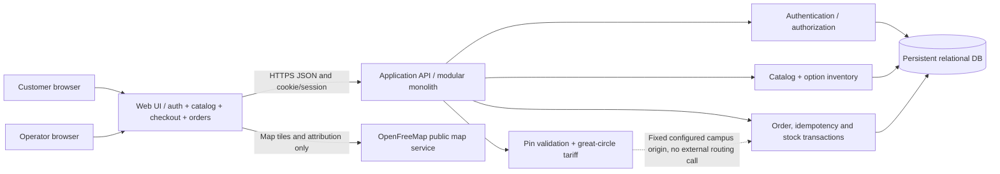
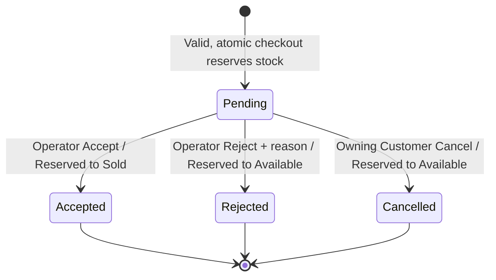
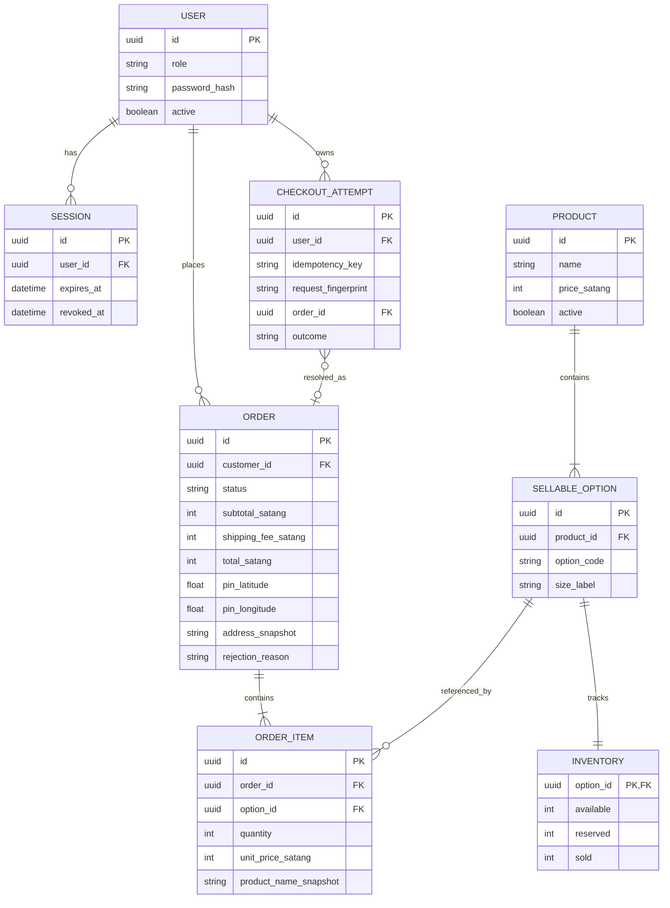
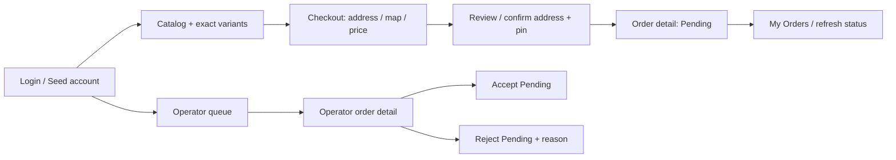

# Campus Store — System-Level Software Design Specification (Part C)

> **Status:** Draft v0.1, 2026-11-02. **Business baseline approved** by FRZ-S1 (DEC-001..034, MAP-COST-001). **Technical choices below are proposed**, not evidence of an inspected/implemented group repository. No application code has been written or tested in this documentation session. Second-team-member architecture review is outstanding.
>
> **Inputs:** `srs.md`, `features.md`, `traceability.md`, `group-project/requirements-log.md`, `group-project/CONTEXT.md`; instructor `group_work_specs_v1.pdf` §§5,6.4,7–8 and `project_deliverable_1_v1.pdf` §3.3. Validate the instructor draft status against later announcements.

## 1. System context, boundaries and decision labels

The product is a **single-store fictional Campus Store** that sells seeded university-themed merchandise through **nationwide delivery only**. The campus-center dispatch point is simulated; no real carrier, road-distance, payment gateway, delivery tracking or automatic address geocoding is in Sprint 1. Customers create persisted Orders and may cancel only their own Pending Orders; Operators share one order queue and may Accept or Reject Pending Orders. A rejection requires a persisted customer-visible reason.

- **[CONFIRMED]** means approved under a DEC/FRZ-S1.
- **[PROPOSED]** means a technical recommendation to verify against the actual group repo and document in a reviewed engineering contract.
- **[REQUIRED GATE]** means an input that must be resolved before a reliable implementation/evidence claim.

**[CONFIRMED]** MapLibre GL JS with OpenFreeMap Public Instance is the interactive destination-pin stack. The mapping portion must not require usage payment, card or paid API key under currently observed provider terms; display correct attribution and do not guarantee perpetual free availability. The backend owns all price, stock, distance, fee and authorization decisions.

**[PROPOSED]** Use the prior plan's React + Vite + TypeScript UI, Express + TypeScript modular monolith API, PostgreSQL + Prisma storage, Vitest/Supertest integration tests, and limited Playwright E2E. **Do not treat this as the actual stack until the group repo/`AGENTS.md` is inspected.** If the group repo is already implemented differently, maintain its conventions and revise this document instead of spawning a parallel app.

## 2. Logical architecture

**Responsibilities:**

| Component | Owns | Does not own |
|---|---|---|
| Browser UI | Forms, map pin selection, user confirmation, loading/error/retry, button lock while submitting | Authoritative stock/price, ownership checks, shipping fee decisions |
| Auth/API boundary | Sessions, current identity, role and owner enforcement, request validation | Trusting `customerId`, amount, status or role from browser |
| Catalog domain | Six products, twelve option definitions, price/stock reads | Editing catalog in Sprint 1 |
| Shipping domain | Fixed verified origin; finite/range-validated destination pin; great-circle distance; band fee | Road routing or proving address text matches pin |
| Order domain | Normalize order lines, idempotency, durable price/address snapshots, reservation/lifecycle transactions | Partial Orders, duplicate reservation, editing original order contents |
| Relational DB | Constraints, unique identifiers, persistent orders/stock, transactional integrity | Client-only mock persistence |
| Map tiles | Display base map and attribution | Authoritative distance, shipping bill or postal address validation |

**Interaction contract:** Browser authenticates → loads catalog (server price/stock) → enters address and selects pin → confirms address+pin → obtains server-side fee/total preview (or quote; endpoint shape proposed below) → sends checkout once with idempotency key → API transaction creates Pending Order and reserves stock → reads back persisted Order. Operator actions and Customer Cancel use atomic status+inventory transitions. Backend remains functional for checkout with a previously selected valid pin even if map tiles fail, subject to reconfirmation (DEC-029).

## 3. Domain state machines and transaction invariants

**[CONFIRMED]** No Pending auto-expiry in Sprint 1. Accepted, Rejected and Cancelled cannot transition again using Sprint 1 workflows. The Customer never edits order contents after submission; correcting an order requires cancelling their own Pending Order and making an independently validated new Order/key. A failed checkout validation creates **no Order and no reservation**. A Rejected Order is different from a failed checkout.

**Stock accounting:** for each exact sellable option, Available/Reserved/Sold are separate nonnegative quantities. With no Sprint 1 restocking, `Available + Reserved + Sold` starts at the seed count and remains conserved. Reservation moves Available→Reserved. Accept moves Reserved→Sold. Reject/Cancel moves Reserved→Available. **Never reserve and decrement twice on Accept.** Across all twelve options, the seed starts at **160 Available / 0 Reserved / 0 Sold**.

**[PROPOSED] Concurrency protection:** use one relational database transaction for a successful submit including line normalization, conditional inventory decrements, reservation increments, snapshots, Order and idempotency record. Conditional `available >= requested` updates or row locks (in deterministic option ordering) prevent lost updates/deadlocks. Accept/Reject/Cancel lock the Order/status and update every affected stock row in the *same* transaction; competing actions cannot both win. Database constraints and rollback prevent partial writes. Test with a real DB, not mocked persistence only.

## 4. Principal data model (proposed relational schema)

**Schema intent (proposed, not applied):**

| Entity | Minimum important fields / constraints | Ownership and immutability |
|---|---|---|
| `User` | account identifier, password hash, `CUSTOMER`/`OPERATOR` role; seeded test identities | User's authenticated identity, never client-selected owner |
| `Session` | user FK, opaque session/token digest, expiry and revocation data | Server-managed; logout revokes/invalidates |
| `Product` | catalog ID/name, active flag, authoritative fixed price | Prices shared across shirt design sizes; later edits don't rewrite past orders |
| `SellableOption` | product FK; optional size S/M/L/XL; unique `(product, size-or-sentinel)` | 12 unique purchasable choices; distinct stock for each shirt size |
| `Inventory` | option PK/FK; nonnegative Available/Reserved/Sold | Stock accounting changes in transactions; later restocking tracked separately when defined |
| `Order` | customer FK, status, recipient/phone, address detail, subdistrict/district/province/postcode, pin lat/long, distance as computed, subtotal/fee/total, rejection reason, timestamps | Customer-submitted data/charges immutable, status/reason evolves under authorized transition |
| `OrderItem` | order/option FKs, quantity, product & size/name and unit-price snapshots | Unique `(order_id, option_id)`; quantity 1–10 after normalization; snapshot frozen |
| `CheckoutAttempt` | customer FK, idempotency key, fingerprint, created result/order reference; unique `(user_id, key)` | Prevent retry duplicate; retention and in-flight/error behavior resolved in F-04 contract |

**Currency design [PROPOSED]:** store THB prices as integer satang rather than binary floating-point; price seeds are whole baht, e.g., shirt A `25000` satang. UI may display ฿250.00. Order total is sum of persisted line snapshots and per-order shipping fee; no tax, discount or payment fields in Sprint 1. **No real schema or migration was created in this session.**

**Order address snapshot:** store independently the validated recipient, leading-zero mobile string, address text, subdistrict, district, approved province identifier/label, five-digit postal-code **string**, chosen pin coordinates, and acknowledged checkout destination. Do **not** assume province/address matches coordinates. Format/range rules follow DEC-031; field length and exact digit acceptance require contract specification.

**Integrity constraints:** unique SKU/option identifier, nonnegative inventory, valid status enum, nonnull original order snapshots, unit price >=0, quantity 1–10, unique order/option, unique idempotency customer/key, referential integrity for ownership and items. Application checks raw lines *before* normalized DB constraints; don't let a `-5` cancel out a `+6` in request aggregation.

## 5. Shipping, mapping and checkout integrity

**[CONFIRMED]** Origin: approximate center of KMUTT Bangmod campus (fictitious dispatch point). **[REQUIRED GATE]** choose and verify one explicit latitude/longitude pair from an auditable source; record source URL/coordinates/date and lock the server config/fixture. Do not invent coordinates. Until this is done, fee implementation and its evidence remain blocked.

**[PROPOSED] Formula:** Haversine/great-circle using radians and a documented fixed Earth-radius convention, with full numerical distance used for fee selection. Fee thresholds are exactly:

| Distance from configured origin, km (unrounded) | Shipping fee |
|---|---:|
| 0 ≤ d ≤ 50 | ฿40 |
| 50 < d ≤ 300 | ฿80 |
| d > 300 | ฿150 |

Use boundary unit tests 50, smallest practical value above 50, 300, and smallest practical value above 300. Only displayed distance is rounded (display digits remain a UX/contract choice). Shipping is **per order**, not per item/weight. Return a safe failure rather than silently charging ฿0 or a guessed fee if backend coordinates/math fail.

**Pin validation:** numeric finite lat ∈ [-90,90] and lon ∈ [-180,180], stored at chosen precision. Delivery is Thailand only (DEC-003); **[REQUIRED GATE]** verify the actual destination eligibility approach (verified Thailand polygon or other documented method) in the F-03 contract, and test non-Thai coordinates without pretending basic range checks prove national inclusion.

**Checkout review:** show all written address fields, selected pin/location and server-calculated price breakdown; require explicit confirmation every time. Changing address/pin revokes previous confirmation. When map tiles fail: no existing valid pin → block and Retry while retaining cart/contact; existing valid pin → display sufficiently clear saved location information for **reconfirmation** before continuing, after backend pin validation. No automatic postal matching or paid geocoding.

**Mapping operational risk:** public map tiles are a third-party availability dependency with no S1 SLA. Provide map attribution; note mapping remains free under provider policies verified by the team at the decision date, but cloud/hosting costs are separate. Preserve map-failure tests and documentation.

## 6. Proposed API conventions and endpoint inventory

**[PROPOSED]** JSON REST under `/api/`, immutable resource IDs, backend-authenticated cookie/session, predictable error envelope (`code`, user-safe `message`, optional field-level `details`), request validation, explicit 400 invalid input, 401 unauthenticated, 403 forbidden role, 404 absent/not-owned (avoid ID existence leak), 409 state/stock/replay conflict, and 500 sanitized unexpected failure. Resolve exact wire contracts in **Part E**; these are architectural placeholders rather than implemented endpoints.

| Method / tentative path | Actor | Purpose and key invariant |
|---|---|---|
| `POST /api/auth/login` | Anonymous | Check seeded credentials; create server-authenticated session |
| `POST /api/auth/logout` | Signed in | Invalidate session; no further access with revoked credential |
| `GET /api/auth/me` | Signed in | Return only safe current-user identity/role |
| `GET /api/products` | Signed in (proposed) | Read active six-product catalog, variants, server price/stock |
| `POST /api/shipping/quote` | Customer | Validate pin/destination; server computes distance/fee; **not** final authority if order state changes |
| `POST /api/orders` | Customer | Requires checkout confirmation + idempotency key; atomic all-or-nothing validation, price snapshot and reservation |
| `GET /api/orders` | Customer | List Orders filtered by authenticated owner in query |
| `GET /api/orders/{id}` | Owner or Operator | Detail and current state; owner-only private reason or all Operator |
| `POST /api/orders/{id}/cancel` | Owning Customer | Pending→Cancelled and one reservation release |
| `GET /api/operator/orders` | Operator | Shared store queue, all Orders |
| `POST /api/operator/orders/{id}/accept` | Operator | Pending→Accepted; Reserved→Sold once |
| `POST /api/operator/orders/{id}/reject` | Operator | Pending→Rejected + nonblank reason; Reserved→Available once |

**Security conventions:** ownership is derived from session, never from a supplied `customerId`. Ignore/reject user-supplied price/total, shipping fee, Order Status or inventory deltas. Use parameterized database access and output encoding. Status, reason and inventory changes occur together. UI button visibility alone is never authorization.

**Idempotency [CONFIRMED principle; PROPOSED mechanics]:** checkout includes unique logical submission key, bound to authenticated customer and canonical validated request fingerprint; first transaction controls Order/reservation, same-key same-request replay returns the existing logical Order, a new intended checkout uses new key, and mismatched payload with reused key returns an explicit conflict rather than modifying an existing Order. **[REQUIRED GATE]** define key format, retention, behavior when original is in progress, behavior on failed validation and HTTP status in the F-04 contract; ensure key storage and Order transaction cannot diverge on a crash.

## 7. Screens, navigation and shared UI states

| Screen | States and error paths to contract |
|---|---|
| Login | Idle, submitting, invalid credentials, network error, successful session, logout |
| Catalog | Loading, seeded list, product/size option selection, insufficient-stock feedback, error; no Sprint 1 edit UI |
| Checkout | Cart summary, required contact/address fields, province dropdown, map selecting/saved pin, quote loading/error, address+pin confirmation, submit pending, successful Order, validation errors; retain form on map tile failure |
| My Orders | Loading, empty, list, forbidden/no-data, latest persisted status on open/refresh, Cancel action only for own Pending |
| Order Detail | Immutable submitted snapshot + address/pin/fees + status, optional rejection reason only on Rejected and for authorized viewer |
| Operator Queue/Detail | All store orders, Pending filtering, Accept/Reject forms, nonblank reason, stale state/conflict errors, refreshed results |

Use accessible form labels, keyboard focus/visible errors and no secrets in browser storage. Loading and conflict states must not falsely display success when backend transaction failed. No proactive notifications, realtime alerts or email in S1.

## 8. Authentication, authorization and privacy

**[CONFIRMED]** Seed Customer and Operator accounts; real login/logout/current identity; password hashes; backend role checks; Customer sees only their own orders; Operators see all store orders and Accept/Reject Pending only; no public sign-up in S1.

**[PROPOSED]** Use server-managed sessions with an opaque credential in `HttpOnly`, `Secure` (HTTPS) cookie and `SameSite` policy appropriate to deployment, password hashing via Argon2id/bcrypt, CSRF defenses if cookie-backed writes, logout session invalidation and expiry checks; never transmit password hashes or session secrets to the browser. Verify against existing repo auth implementation rather than replacing it by assumption. Exact expiry/refresh behavior belongs in F-01 contract.

| Operation | Anonymous | Customer (owner) | Customer (other) | Operator |
|---|---|---|---|---|
| Login | Yes | N/A | N/A | N/A |
| Current identity / logout | No | Own | Own | Own |
| Browse catalog | No (proposed S1 UI policy) | Yes | Yes | Yes |
| Checkout / submit Order | No | Yes | Yes for own checkout only | No (unless separately a Customer identity; not approved) |
| My Orders / order details | No | Own Orders | Denied | All Campus Store Orders |
| Cancel Pending | No | Own Pending only | Denied | No under S1 Customer Cancel rule |
| Accept/Reject Pending | No | Denied | Denied | All store Pending Orders |
| Edit original submitted Order contents | No | Denied | Denied | Denied in S1 |
| Edit catalog / prices | No | Denied | Denied | Not in S1 (planned S2) |
| Payment/notifications | Not in S1 | Not in S1 | Not in S1 | Not in S1 |

**Authorization tests** include unauthenticated, wrong role, cross-customer ID guessing, replay after logout, attempted client-supplied Customer ID, status/reason access of someone else's Order, and concurrent role-authorized transitions. Minimize stored delivery PII in logs/screenshots and provide only necessary fields to the intended actor.

## 9. Migrations, seeding, configuration and later GCP deployment

**[PROPOSED] Database lifecycle:** migration-managed relational schema with constraints/indexes; idempotent deterministic seed command for at least two Customer test accounts and one Operator, six products, twelve exact options, 160 Available total. **Only seed catalog stock initially**; avoid running a destructive stock reset on real Orders. Record seed versions and expected totals. Keep example/demo passwords out of Git and public PDF; use local/private test handoff where appropriate.

**[PROPOSED] Environment variables:** database URL, session secret, API origin/CORS, environment mode, shipping origin lat/lon (verified fixed), mapping style URL (public) and log level. Provide names/sample placeholders in `.env.example` but never real secrets. No map API key or credit card requirement; GCP cost assumption must not be conflated with map tile fees.

**[PROPOSED] Lab 5 target:** stateless containerized UI/API (e.g., Cloud Run) talking to a durable managed PostgreSQL instance (e.g., Cloud SQL) under appropriate GCP access given by the course, secure secret injection, health checks, migrations and repeatable CI/CD from accepted `main` commit. Choose exact GCP services only when Lab 5 guidance and project budget are known. Deliverable 1 requires documented local setup/build/test and Docker/GCP-ready SDS, **not** a live GCP URL or completed pipeline.

## 10. Engineering gates, risks and verification

| Risk/gap | Severity for deadline | Required action / owner before implementation |
|---|---|---|
| Fixed geographic origin unverified | **Blocker for trustworthy shipping** | Verify/document exact coordinate and source; freeze server config; author 50/300km boundary tests |
| Group repository and `AGENTS.md` not inspected | **Blocker for executable file-level plan** | Read-only inspect branch, stack, existing tests/schema before any code; adjust architecture in review |
| Sprint 1 bigger than instructor minimum, two students, 8 Nov deadline | High | Agree feature dependency order, stop optional enhancements, document slippage via approved scope change |
| Inventory race/transaction semantics | High | F-04/05/06 contract and integration tests on real DB; no mock-only claim |
| Duplicate checkout replay vs concurrent in-flight | High | F-04 deterministic key/fingerprint/retention/response contract, DB unique constraint and race tests |
| Cookie/session security and account safety | High | F-01 contract + negative auth/ownership tests and secrets review |
| Third-party map downtime/cost/attribution | Medium | F-03 outage/reconfirmation test, preserve cart, attribution, source policy check |
| Unspecified Thai pin-territory check and postcode/province dataset | Medium | F-03 validated source/dataset, documented chosen method and edge cases |
| Instructor draft possibly superseded | High | Compare with current LEB2/TA announcement before final submission |
| Part E/F evidence missing | **Deliverable gap** | Write/review Part E contracts before code; then execute, record SHA/tests/PRs/PDF Part F |

**Status of this SDS:** design draft only. The architecture and endpoint/data shapes are not confirmed team technical decisions or tested code. Reconcile them with real repository, course instructions and teammate feedback before implementation. Any business change must pass FRZ-S1 change control.
